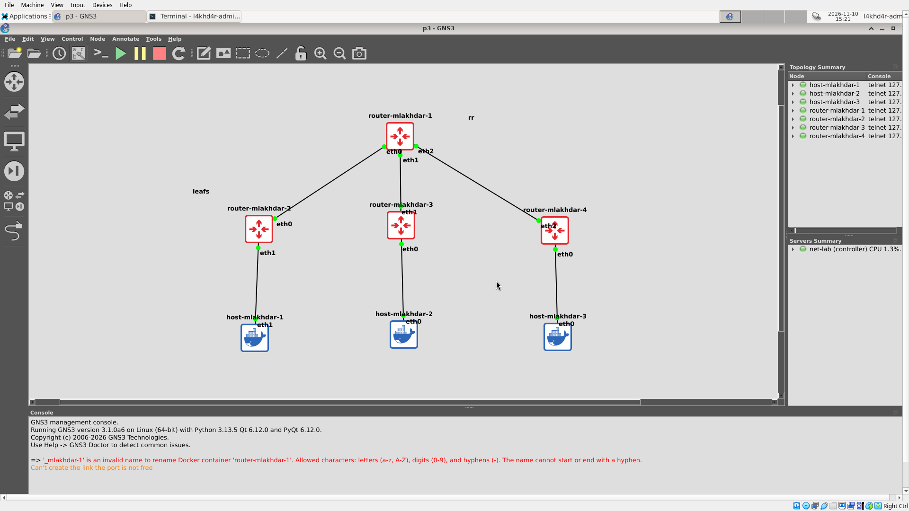
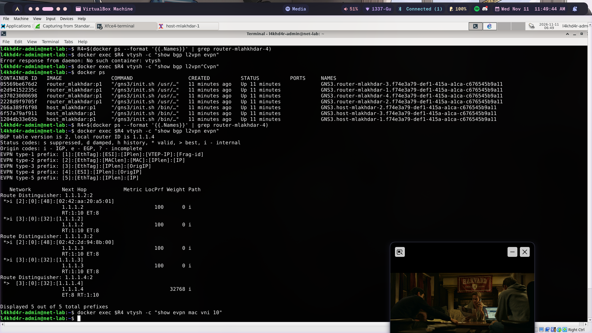
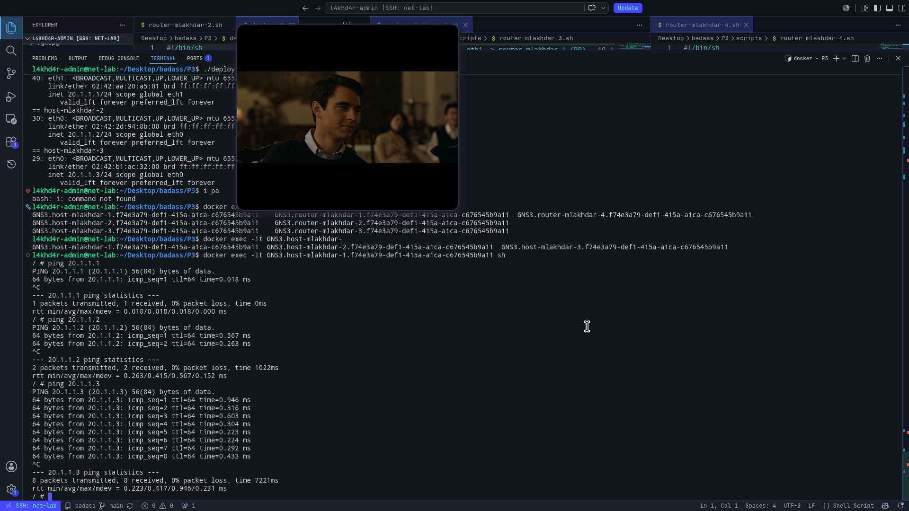
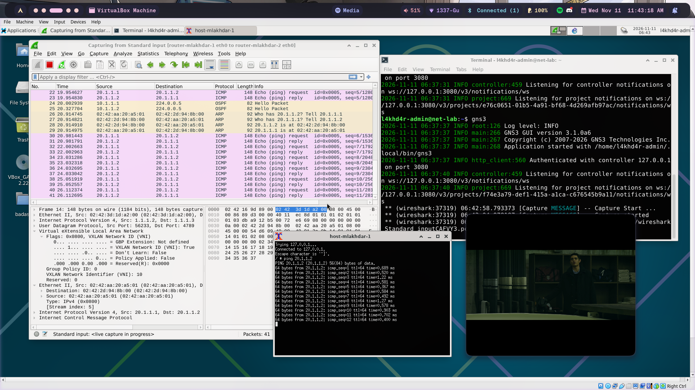

# P3 — Discovering BGP with EVPN

A small data center: **3 leaves (VTEPs)** with one host each, and a **route reflector**
in the middle. The hosts share one LAN (**20.1.1.0/24, VNI 10**) over VXLAN, like in P2,
but the VTEPs no longer flood to find each other: **BGP EVPN announces** the VTEPs and the
host MAC addresses.



---

## The three layers

| Layer | Protocol | Job | Runs on |
|---|---|---|---|
| Underlay | **OSPF** (area 0) | make every loopback (1.1.1.x) reachable | all 4 routers |
| Overlay control plane | **iBGP + EVPN** (AS 1) | announce VTEPs (type 3) and MACs (type 2) | all 4 routers |
| Overlay data plane | **VXLAN** (VNI 10, UDP 4789) | carry the hosts' Ethernet frames | the 3 leaves |

OSPF and BGP **decide**, VXLAN **carries**: control plane vs data plane.

---

## Topology

```text
                         router-mlakhdar-1  (route reflector)
                          lo 1.1.1.1
              eth0 10.1.1.1   eth1 10.1.1.5   eth2 10.1.1.9
                 /                 |                 \
       eth0 10.1.1.2       eth1 10.1.1.6       eth2 10.1.1.10
     router-mlakhdar-2   router-mlakhdar-3    router-mlakhdar-4     (leaves / VTEPs)
       lo 1.1.1.2          lo 1.1.1.3           lo 1.1.1.4
          eth1               eth0                 eth0              (bridge ports, no IP)
           |                  |                    |
     host-mlakhdar-1    host-mlakhdar-2      host-mlakhdar-3
     eth1 20.1.1.1      eth0 20.1.1.2        eth0 20.1.1.3
```

### IP plan

| Link / interface | Subnet | Addresses |
|---|---|---|
| RR eth0 ↔ router-mlakhdar-2 eth0 | 10.1.1.0/30 | 10.1.1.1 / 10.1.1.2 |
| RR eth1 ↔ router-mlakhdar-3 eth1 | 10.1.1.4/30 | 10.1.1.5 / 10.1.1.6 |
| RR eth2 ↔ router-mlakhdar-4 eth2 | 10.1.1.8/30 | 10.1.1.9 / 10.1.1.10 |
| Loopbacks | /32 | 1.1.1.1, 1.1.1.2, 1.1.1.3, 1.1.1.4 |
| Hosts (overlay) | 20.1.1.0/24 | 20.1.1.1, 20.1.1.2, 20.1.1.3 |

A **/30** has exactly 2 usable addresses: one for each end of a point-to-point link.
A **loopback** never goes down while the router is alive, so it is used as the router's
identity: OSPF router-id, BGP session source, and VTEP address.

---

## Roles

| | router-mlakhdar-1 (RR) | router-mlakhdar-2/3/4 (leaves) |
|---|---|---|
| OSPF | ✅ all links + loopback | ✅ uplink + loopback |
| iBGP, `l2vpn evpn` | ✅ reflects routes | ✅ one session, to 1.1.1.1 |
| `route-reflector-client` | ✅ toward each leaf | — |
| `advertise-all-vni` | — | ✅ |
| `vxlan10` + `br0` (VTEP) | ❌ | ✅ |
| Host attached | ❌ | ✅ |

**Why a route reflector?** In iBGP, a route learned from one iBGP peer is never passed on
to another iBGP peer (loop prevention, since AS_PATH does not change inside one AS).
Without an RR, every leaf would need a session to every other leaf (a full mesh:
n × (n−1) / 2 sessions). The RR is allowed to **reflect** routes between its clients,
so each leaf needs **one** session.

The RR is **not a VTEP**, but it still **forwards** the VXLAN packets between leaves:
it is a normal router in the underlay and never opens the envelope.

---

## Files

| File | Role |
|---|---|
| `P3.gns3project` | GNS3 portable export of the topology |
| `deploy.sh` | copies each node's script into its container and runs it |
| `scripts/router-mlakhdar-1.sh` | RR: IPs, OSPF, BGP with dynamic neighbors and route-reflector-client |
| `scripts/router-mlakhdar-2/3/4.sh` | leaves: IPs, OSPF, BGP EVPN, `vxlan10` + `br0` |
| `scripts/host-mlakhdar-1/2/3.sh` | hosts: 20.1.1.x/24 (`noip` mode: port up only) |

Router configuration goes through `vtysh`, so it appears in `show running-config` and
is saved in `/etc/frr/frr.conf`. The Docker images from P1 are reused unchanged.

---

## Run

1. Build the P1 images if needed: `./P1/image_builder.sh`
2. In GNS3: **File → Import portable project** → `P3/P3.gns3project`, then **Start** all nodes.
3. Follow the subject's order:

```sh
cd P3
./deploy.sh routers       # OSPF + BGP EVPN + VXLAN on the 4 routers
                          # wait ~30 s for OSPF and BGP to come up
./deploy.sh hosts-noip    # hosts' ports up, no IP -> type 2 routes appear
./deploy.sh hosts         # hosts get 20.1.1.x/24  -> ping works
```

`./deploy.sh` alone applies everything. GNS3 Docker nodes lose their configuration
when they restart, so run it again after a restart.

---

## Key configuration

### Leaf (router-mlakhdar-2)

```text
router ospf
 ospf router-id 1.1.1.2
interface eth0
 ip address 10.1.1.2/30
 ip ospf area 0
interface lo
 ip address 1.1.1.2/32
 ip ospf area 0
router bgp 1
 neighbor 1.1.1.1 remote-as 1          ! iBGP, to the RR only
 neighbor 1.1.1.1 update-source lo     ! session from our loopback
 address-family l2vpn evpn
  neighbor 1.1.1.1 activate
  advertise-all-vni                    ! announce VNI 10 (type 3) and its MACs (type 2)
```

```sh
ip link add vxlan10 type vxlan id 10 local 1.1.1.2 dstport 4789 nolearning
ip link add br0 type bridge
ip link set eth1 master br0
ip link set vxlan10 master br0
```

Compared to P2: **no `remote`, no `group`** (the VTEP list comes from type 3 routes),
`local` is the **loopback**, and **`nolearning`** (remote MACs come from type 2 routes).

### Route reflector (router-mlakhdar-1)

```text
router bgp 1
 neighbor ibgp peer-group
 neighbor ibgp remote-as 1
 neighbor ibgp update-source lo
 bgp listen range 1.1.1.0/29 peer-group ibgp   ! accept any leaf loopback
 address-family l2vpn evpn
  neighbor ibgp activate
  neighbor ibgp route-reflector-client
```

---

## Verify

### 1. Underlay: OSPF

```sh
vtysh -c "show ip route"          # on router-mlakhdar-4
```
```text
O>* 1.1.1.1/32 [110/10] via 10.1.1.9, eth2
O>* 1.1.1.2/32 [110/20] via 10.1.1.9, eth2
O>* 1.1.1.3/32 [110/20] via 10.1.1.9, eth2
O>* 10.1.1.0/30 [110/20] via 10.1.1.9, eth2
O>* 10.1.1.4/30 [110/20] via 10.1.1.9, eth2
```
`O` = learned by OSPF, `>*` = selected and installed. `[110/20]` = administrative distance
110 (OSPF) / cost 20 (two links of cost 10: leaf → RR → leaf). Every path goes through
the RR (10.1.1.9), the only way out of this leaf.

### 2. BGP sessions

```sh
vtysh -c "show bgp summary"
```
Each leaf has **one** neighbor, `1.1.1.1`, in both the IPv4 Unicast and L2VPN EVPN
sections. A number in `State/PfxRcd` means the session is **Established**.

### 3. EVPN routes

```sh
vtysh -c "show bgp l2vpn evpn"
```


```text
Route Distinguisher: 1.1.1.2:2
 *>i [2]:[0]:[48]:[02:42:aa:20:a5:01]     <- host-mlakhdar-1's MAC, behind 1.1.1.2
                 1.1.1.2     100   0 i
                 RT:1:10 ET:8
 *>i [3]:[0]:[32]:[1.1.1.2]               <- router-mlakhdar-2 is a VTEP for VNI 10
Route Distinguisher: 1.1.1.4:2
 *>  [3]:[0]:[32]:[1.1.1.4]               <- our own route (weight 32768, no "i")
```

| Field | Meaning |
|---|---|
| `[3]` type 3 (IMET) | "I am a VTEP for VNI 10": replaces P2's `remote` / `group` |
| `[2]` type 2 (MAC/IP) | "this MAC is behind me": replaces flood-and-learn |
| `*>i` | valid, best, learned through iBGP (reflected by the RR) |
| Next hop | the VTEP to send VXLAN packets to |
| RD `1.1.1.2:2` | Route Distinguisher: makes each leaf's routes unique |
| RT `1:10` | Route Target: AS 1, VNI 10, decides which leaves import the route |
| ET `8` | Encapsulation type 8 = VXLAN |
| weight `32768` | route originated by this router |

**Type 3 routes** exist as soon as `vxlan10` is configured, with no host running.
**Type 2 routes** appear when a host sends its first frame, even **before it has an IP**,
and are **withdrawn** when the MAC ages out of the bridge (300 s without traffic).

### 4. Hosts

```sh
ping -c 3 20.1.1.2        # from host-mlakhdar-1
ping -c 3 20.1.1.3
```


### 5. Wireshark (link RR ↔ router-mlakhdar-2)



- **OSPF Hello** `10.1.1.x → 224.0.0.5`: underlay control plane
- **VXLAN** outer `1.1.1.2 → 1.1.1.3`, UDP 4789, **VNI 10**, inner `20.1.1.1 → 20.1.1.2` ICMP
- The outer addresses are **loopbacks**, reachable thanks to OSPF
- The packet crosses the RR, which forwards it without opening it
- 148 bytes per ping frame: **50 bytes** of VXLAN encapsulation, as in P2

---

## From P2 to P3

| | P2 static | P2 multicast | P3 BGP EVPN |
|---|---|---|---|
| Find the other VTEPs | `remote <ip>` by hand | join group 239.1.1.1 | type 3 routes |
| Learn remote MACs | flood and learn | flood and learn | type 2 routes |
| Underlay | one shared subnet | one shared subnet | OSPF, routed |
| VTEP address | link IP | link IP | loopback |
| Scales | poorly | needs multicast routing | yes |

---

## Troubleshooting

| Symptom | Check |
|---|---|
| no `O` routes | `show ip ospf neighbor`: state must be `Full`; same area, unique router-ids |
| BGP neighbor not Established | `ping 1.1.1.1 -I 1.1.1.x` from the leaf: loopbacks must be reachable first |
| no type 3 route | `show evpn vni`: VNI 10 must be listed; `vxlan10` must be in `br0` and up |
| no type 2 route | the host is quiet: its MAC aged out; send traffic from it |
| hosts cannot ping | right host port in `br0` (`bridge link`), same subnet on the hosts |