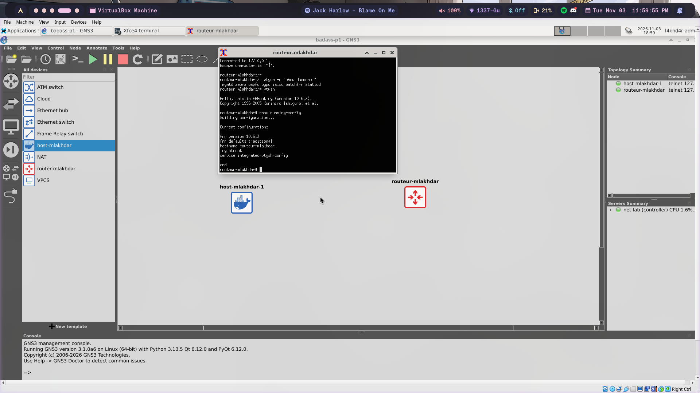

# BADASS — BGP At Doors of Autonomous Systems is Simple

Network simulation project built with **GNS3** and **Docker**: from basic router images, to a VXLAN, to a small data center running **BGP EVPN**.

| Part | Topic | Status |
|---|---|---|
| [P1](P1/) | GNS3 + Docker images (host, FRR router) | ✅ Done |
| P2 | VXLAN (VNI 10), static then multicast | ⏳ In progress |
| P3 | BGP EVPN with route reflector, OSPF underlay | ⏳ To do |

---

## Requirements

- A Linux virtual machine
- Docker
- GNS3 (GUI + server), with Docker support enabled

## Quick start

```sh
git clone https://github.com/l4khd4r/badass
cd badass
./P1/image_builder.sh        # builds host_mlakhdar:p1 and router_mlakhdar:p1
```

Then in GNS3:

1. **Edit → Preferences → Docker containers → New**, and add both images as templates.
2. **File → Import portable project**, and pick `P1/P1.gns3project` (or `P2/`, `P3/`).
3. Start all nodes with ▶ and open the consoles by double-clicking a node.

> The `.gns3project` files contain the topology only. GNS3 does not pack Docker
> images in the export, so always build the images first.

---

## Repository layout

```text
badass/
├── P1/                        GNS3 + Docker
│   ├── image_builder.sh       builds both images
│   ├── P1.gns3project         GNS3 portable export
│   ├── host/
│   │   └── Dockerfile         Alpine + busybox
│   └── router/
│       ├── Dockerfile         Alpine + FRRouting
│       ├── start-router.sh    starts the FRR daemons
│       ├── daemons            enabled daemons: zebra, bgpd, ospfd, isisd
│       ├── frr.conf           base config, no IP address
│       └── vtysh.conf         vtysh saves to a single frr.conf
├── P2/                        VXLAN
├── P3/                        BGP EVPN
└── docs/                      notes and learning roadmap
```

---

## P1 — GNS3 configuration with Docker

Two images, reused in every part. **No IP address is configured in either image.**

### Host — `host_mlakhdar:p1`

- Alpine Linux, whose userland is **busybox** (`sh`, `ip`, `ping`, `ps`, ...)
- Extra tools: `iproute2`, `iputils`, `tcpdump`, `net-tools`

### Router — `router_mlakhdar:p1`

- Alpine Linux + **FRRouting 10**
- Daemons started by `watchfrr`, which also restarts them if they crash:

| Daemon | Role |
|---|---|
| `zebra` | Routing manager: installs the routes learned by the protocols into the kernel |
| `bgpd` | BGP, used in P3 for EVPN and the route reflector |
| `ospfd` | OSPF, the P3 underlay that makes the loopbacks reachable |
| `isisd` | IS-IS routing engine (required by the subject) |
| `mgmtd`, `staticd` | FRR core daemons, always started |

### Topology

Two nodes, no link: `host-mlakhdar-1` and `routeur-mlakhdar`.

> GNS3 3.x does not allow `_` in Docker node names, so the nodes use `-`.

### Verify

On the **router**:

```sh
ps                               # watchfrr, zebra, mgmtd, staticd, bgpd, ospfd, isisd
vtysh -c "show daemons"
vtysh -c "show running-config"   # no IP address
ip -4 addr                       # only 127.0.0.1 on lo
```

On the **host**:

```sh
ps          # /bin/sh
ip addr     # no inet on eth0
```

---

## P2 — VXLAN

_Coming soon._

## P3 — BGP EVPN

_Coming soon._

---

## Glossary

| Term | Meaning |
|---|---|
| **BGP** | Path-vector routing protocol that runs the Internet |
| **MP-BGP** | BGP extension carrying other address families (EVPN, IPv6, ...) |
| **EVPN** | BGP family that advertises MAC/IP addresses; the control plane for VXLAN |
| **VXLAN** | Encapsulates L2 Ethernet frames in UDP (port 4789); 24-bit VNI |
| **VTEP** | Device that encapsulates and decapsulates VXLAN traffic |
| **Route reflector** | iBGP router that re-advertises routes so leaves don't need a full mesh |
| **OSPF / IS-IS** | Link-state interior routing protocols |
| **Underlay / overlay** | Real IP network (underlay) vs virtual L2 network on top (overlay) |