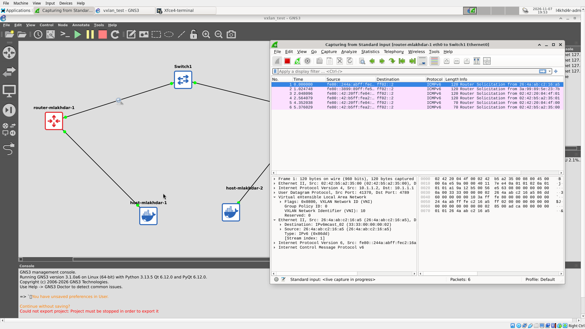
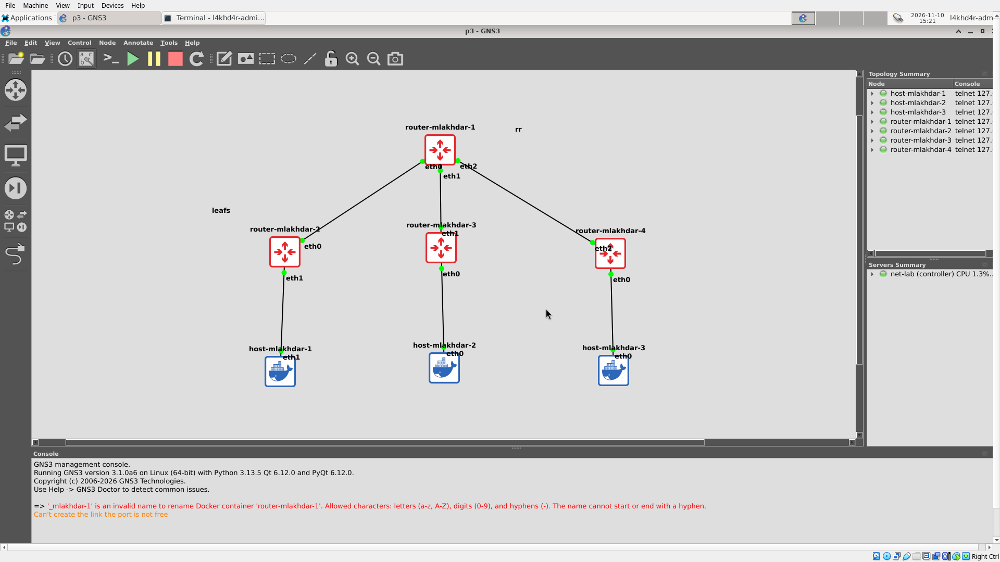

# BADASS — BGP At Doors of Autonomous Systems is Simple

Network simulation project built with **GNS3** and **Docker**: from basic router images, to a VXLAN, to a small data center running **BGP EVPN**.

| Part | Topic | Status |
|---|---|---|
| [P1](P1/) | GNS3 + Docker images (host, FRR router) | ✅ Done |
| [P2](P2/) | VXLAN (VNI 10), static then multicast | ✅ Done |
| [P3](P3/) | BGP EVPN with route reflector, OSPF underlay | ✅ Done |

---

## Requirements

- A Linux virtual machine
- Docker
- GNS3 (GUI + server), with Docker support enabled

## Quick start

```sh
git clone https://github.com/l4khd4r/badass
cd badass
./P1/image_builder.sh        # builds host_mlakhdar:p1 and router_mlakhdar:p1
```

Then in GNS3:

1. **Edit → Preferences → Docker containers → New**, and add both images as templates.
2. **File → Import portable project**, and pick `P1/P1.gns3project` (or `P2/`, `P3/`).
3. Start all nodes with ▶ and open the consoles by double-clicking a node.
4. From P2 on, apply the configuration with the part's deploy script (e.g. `./P2/deploy.sh static`).

> The `.gns3project` files contain the topology only. GNS3 does not pack Docker
> images in the export, so always build the images first.

---

## Repository layout

```text
badass/
├── P1/                        GNS3 + Docker
│   ├── image_builder.sh       builds both images
│   ├── P1.gns3project         GNS3 portable export
│   ├── host/
│   │   └── Dockerfile         Alpine + busybox
│   └── router/
│       ├── Dockerfile         Alpine + FRRouting
│       ├── start-router.sh    starts the FRR daemons
│       ├── daemons            enabled daemons: zebra, bgpd, ospfd, isisd
│       ├── frr.conf           base config, no IP address
│       └── vtysh.conf         vtysh saves to a single frr.conf
├── P2/                        VXLAN
│   ├── P2.gns3project         GNS3 portable export
│   ├── README.md              topology, IP plan, how to run and verify
│   ├── deploy.sh              applies the config to the running nodes (static | multicast)
│   └── scripts/
│       ├── router-mlakhdar-1.sh   VTEP 1: underlay IP, vxlan10, br0
│       ├── router-mlakhdar-2.sh   VTEP 2: same, mirrored addresses
│       ├── host-mlakhdar-1.sh     30.1.1.1/24
│       └── host-mlakhdar-2.sh     30.1.1.2/24
├── P3/                        BGP EVPN
│   ├── P3.gns3project         GNS3 portable export
│   ├── README.md              topology, roles, how to run and verify
│   ├── deploy.sh              routers | hosts-noip | hosts | all
│   └── scripts/
│       ├── router-mlakhdar-1.sh   route reflector: OSPF + BGP RR
│       ├── router-mlakhdar-2.sh   leaf / VTEP: OSPF + BGP EVPN + vxlan10 + br0
│       ├── router-mlakhdar-3.sh
│       ├── router-mlakhdar-4.sh
│       ├── host-mlakhdar-1.sh     20.1.1.1/24
│       ├── host-mlakhdar-2.sh     20.1.1.2/24
│       └── host-mlakhdar-3.sh     20.1.1.3/24
└── docs/                      notes and learning roadmap
```

---

## P1 — GNS3 configuration with Docker

Two images, reused in every part. **No IP address is configured in either image.**

### Host — `host_mlakhdar:p1`

- Alpine Linux, whose userland is **busybox** (`sh`, `ip`, `ping`, `ps`, ...)
- Extra tools: `iproute2`, `iputils`, `tcpdump`, `net-tools`

### Router — `router_mlakhdar:p1`

- Alpine Linux + **FRRouting 10**
- Daemons started by `watchfrr`, which also restarts them if they crash:

| Daemon | Role |
|---|---|
| `zebra` | Routing manager: installs the routes learned by the protocols into the kernel |
| `bgpd` | BGP, used in P3 for EVPN and the route reflector |
| `ospfd` | OSPF, the P3 underlay that makes the loopbacks reachable |
| `isisd` | IS-IS routing engine (required by the subject) |
| `mgmtd`, `staticd` | FRR core daemons, always started |

### Topology

Two nodes, no link: `host-mlakhdar-1` and `routeur-mlakhdar`.

> GNS3 3.x does not allow `_` in Docker node names, so the nodes use `-`.

### Verify

On the **router**:

```sh
ps                               # watchfrr, zebra, mgmtd, staticd, bgpd, ospfd, isisd
vtysh -c "show daemons"
vtysh -c "show running-config"   # no IP address
ip -4 addr                       # only 127.0.0.1 on lo
```

On the **host**:

```sh
ps          # /bin/sh
ip addr     # no inet on eth0
```

---

## P2 — VXLAN

Two hosts on the **same LAN (30.1.1.0/24)**, behind two different routers, joined by a
**VXLAN tunnel (VNI 10, UDP 4789)** over an IP network (10.1.1.0/24).
Full details in [P2/README.md](P2/README.md).


### Topology

```text
host-mlakhdar-1 ── router-mlakhdar-1 ──── Switch1 ──── router-mlakhdar-2 ── host-mlakhdar-2
   30.1.1.1          (VTEP) 10.1.1.1               10.1.1.2 (VTEP)          30.1.1.2
                        └──────────── vxlan10, VNI 10 ────────────┘
```

On each router, `br0` (a Linux bridge) joins `eth1` (the host port, no IP) and `vxlan10`
(the tunnel). The router acts as a switch whose second port is a tunnel to the other router.

| | Underlay | Overlay |
|---|---|---|
| What | real network between the routers | virtual LAN between the hosts |
| Addresses | 10.1.1.0/24 | 30.1.1.0/24 |
| In a packet | outer IP + UDP 4789 + VXLAN header | inner Ethernet + IP + ICMP |

### Two modes

| Mode | Where broadcast / unknown (BUM) traffic goes | vxlan10 option |
|---|---|---|
| **static** | to one fixed peer | `remote <other VTEP>` |
| **multicast** | to a group every VTEP joins | `group 239.1.1.1` |

In both modes the VTEPs **flood and learn**: unknown frames are flooded, and each VTEP
learns which MAC lives behind which remote VTEP from the replies.

### Run

```sh
./P2/deploy.sh static       # or: ./P2/deploy.sh multicast
```

### Verify

```sh
ping -c 4 30.1.1.2                         # from host-mlakhdar-1
ip -d link show vxlan10                    # router: "remote 10.1.1.2" or "group 239.1.1.1"
bridge fdb show br br0 | grep vxlan10      # router: learned MAC → remote VTEP
```

In Wireshark (filter `vxlan`), each frame carries the hosts' ping (30.1.1.x) inside an
outer packet between the VTEPs (10.1.1.x, UDP 4789, VNI 10): **50 bytes** of overhead.

---

## P3 — BGP EVPN

A small data center: a **route reflector** and **3 leaves** (VTEPs), each with one host.
The hosts share one LAN (**20.1.1.0/24, VNI 10**) over VXLAN, and **BGP EVPN** announces
the VTEPs and the host MACs instead of flooding. Full details in [P3/README.md](P3/README.md).


| Layer | Protocol | Job |
|---|---|---|
| Underlay | **OSPF** area 0 | make every loopback (1.1.1.x) reachable |
| Overlay control plane | **iBGP + EVPN**, AS 1 | type 3 = VTEPs, type 2 = MACs |
| Overlay data plane | **VXLAN** VNI 10 | carry the hosts' frames between leaves |

Each leaf has **one** BGP session, to the route reflector, which reflects the routes
between leaves (no iBGP full mesh needed).

### Run

```sh
./P3/deploy.sh routers      # then wait ~30 s
./P3/deploy.sh hosts-noip   # type 2 routes appear before any IP
./P3/deploy.sh hosts        # hosts get 20.1.1.x/24
```

### Verify

```sh
vtysh -c "show ip route"            # O>* routes to every loopback, via the RR
vtysh -c "show bgp summary"         # one neighbor: 1.1.1.1, Established
vtysh -c "show bgp l2vpn evpn"      # [3] per VTEP, [2] per active host MAC
ping 20.1.1.3                       # from host-mlakhdar-1
```

---

## Glossary

| Term | Meaning |
|---|---|
| **BGP** | Path-vector routing protocol that runs the Internet |
| **MP-BGP** | BGP extension carrying other address families (EVPN, IPv6, ...) |
| **EVPN** | BGP family that advertises MAC/IP addresses; the control plane for VXLAN |
| **VXLAN** | Encapsulates L2 Ethernet frames in UDP (port 4789); 24-bit VNI |
| **VNI** | VXLAN Network Identifier: the segment number, like a VLAN ID but ~16M values |
| **VTEP** | Device that encapsulates and decapsulates VXLAN traffic |
| **BUM traffic** | Broadcast, Unknown-unicast, Multicast: frames a VTEP must flood |
| **Flood and learn** | VTEPs flood unknown frames and learn MAC → VTEP mappings from traffic |
| **Multicast group** | An address (e.g. 239.1.1.1) that receivers join; one packet reaches all members |
| **Linux bridge** | Software switch (`br0`) that forwards frames between its ports by MAC |
| **iBGP / eBGP** | BGP inside one AS / between different ASes |
| **AS** | Autonomous System: a network under one administration, identified by an ASN |
| **Route reflector** | iBGP router that re-advertises routes so leaves don't need a full mesh |
| **OSPF / IS-IS** | Link-state interior routing protocols |
| **Loopback** | Virtual interface that never goes down: stable router identity |
| **Type 2 / type 3** | EVPN routes: MAC advertisement / VTEP (inclusive multicast) announcement |
| **RD / RT** | Route Distinguisher (makes a route unique) / Route Target (decides who imports it) |
| **Underlay / overlay** | Real IP network (underlay) vs virtual L2 network on top (overlay) |