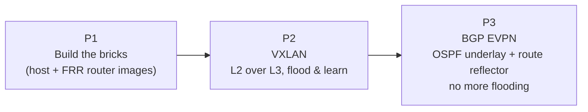

# BADASS — Knowledge Base

> [!abstract] What this project is
> **BADASS** = *BGP At Doors of Autonomous Systems is Simple*.
> It is a **network simulation lab** (GNS3 + Docker + FRRouting) that walks from
> "a container that can route" to "a small data-center fabric that builds a virtual
> Layer-2 network over a routed IP network, and advertises who lives where with BGP EVPN".
>
> It is not an app. The deliverables are **Docker images**, **GNS3 topologies** and
> **configuration scripts**, and what you are really building is *understanding* of how
> modern data-center networks work.

## The story in one picture

| Part | Question it answers | Main note |
|---|---|---|
| P1 | *What is a router/host in this lab, and how is it built?* | [[P1 - Overview]] |
| P2 | *How can two hosts be on the same LAN when routers separate them?* | [[P2 - Overview]] |
| P3 | *How does a data center scale that, without flooding and without hand-written peers?* | [[P3 - Overview]] |

---

## 🗺️ Map of the vault

### Start here
- [[01 Lab Workflow]] — how GNS3, Docker and the deploy scripts fit together
- [[learning-roadmap]] — the original study plan
- [[Concept Map]] — how every concept connects to every other one

### P1 — GNS3 + Docker
- [[P1 - Overview]]
- [[P1 - Host Image]]
- [[P1 - Router Image]]
- [[P1 - FRR Configuration Files]]

### P2 — VXLAN
- [[P2 - Overview]]
- [[P2 - Script Walkthrough]]
- [[P2 - Packet Walk (Flood and Learn)]]
- [[P2 - Verification and Troubleshooting]]

### P3 — BGP EVPN
- [[P3 - Overview]]
- [[P3 - Underlay with OSPF]]
- [[P3 - BGP and the Route Reflector]]
- [[P3 - EVPN Route Types]]
- [[P3 - Script Walkthrough]]
- [[P3 - Packet Walk (EVPN)]]
- [[P3 - Verification and Troubleshooting]]

### Concepts (one note per idea)
- Layer 2 / Layer 3: [[Ethernet and MAC Addresses]] · [[ARP]] · [[IPv4 and Subnetting]] · [[Linux Bridge]]
- Overlays: [[Underlay vs Overlay]] · [[VXLAN]] · [[VTEP]] · [[VNI]] · [[BUM Traffic]] · [[Flood and Learn]] · [[Encapsulation Overhead]]
- Routing: [[Routing Basics]] · [[Loopback Interface]] · [[OSPF]] · [[BGP]] · [[iBGP vs eBGP]] · [[Route Reflector]] · [[MP-BGP]]
- Control plane for overlays: [[EVPN]] · [[Route Distinguisher and Route Target]] · [[Control Plane vs Data Plane]]
- Tooling: [[FRRouting]] · [[Docker in GNS3]]

### Reference
- [[Glossary]]
- [[Commands Cheatsheet]]
- [[Defense Q&A]] — questions an evaluator is likely to ask, with answers
- [[Repo Notes and Known Gaps]] — small inconsistencies found in the repo
- [[Obsidian Setup]] — theme, CSS snippet, graph colours, plugins

---

## Screenshots

| | |
|---|---|
| P1 topology | ![[p1.png]] |
| P2 topology | ![[p2.png]] |
| P3 topology | ![[p3-topology.png]] |
