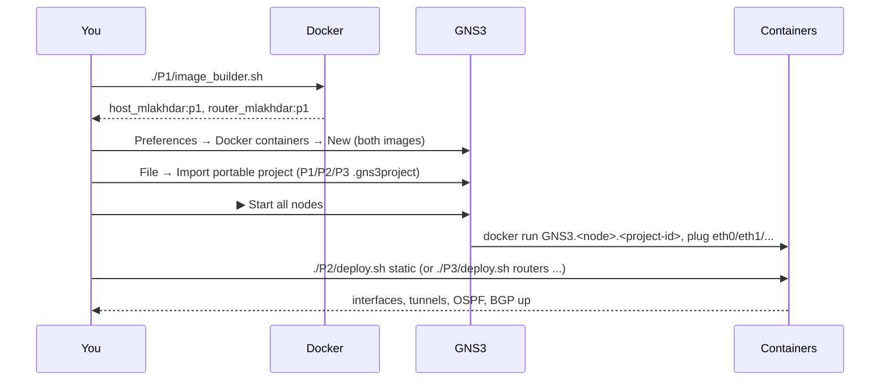

# Lab Workflow

How the pieces of the repo are used together. Back to [[00 Home]].

## The three tools

| Tool | Job in this lab |
|---|---|
| **Docker** | Packages a tiny Linux system (a "host" or a "router") as an image |
| **GNS3** | Draws the topology, starts one container per node, and plugs virtual cables between them |
| **Shell scripts** (`deploy.sh` + `scripts/*.sh`) | Push the configuration (IP addresses, VXLAN, OSPF, BGP) into the running containers |

> [!important] Separation of concerns
> The images are **generic** (no IP address, no protocol config — the subject requires it).
> The **topology** lives in the `.gns3project` file.
> The **configuration** lives in the scripts.
> So the same two images are reused by P1, P2 and P3 unchanged.

## End-to-end flow



## Step by step

1. **Build the images** (once):
   ```sh
   ./P1/image_builder.sh
   ```
   This runs two `docker build` commands and produces `host_mlakhdar:p1` and `router_mlakhdar:p1`.
   See [[P1 - Overview]].

2. **Register the images in GNS3**: *Edit → Preferences → Docker containers → New*.
   GNS3 now knows them as node templates.

3. **Import a topology**: *File → Import portable project* → `P1/P1.gns3project`, `P2/P2.gns3project` or `P3/P3.gns3project`.
   > [!warning] The `.gns3project` export contains the **topology only**, not the Docker images. Always build the images first.

4. **Start the nodes** (▶). Double-click a node to open its console.

5. **Apply the configuration** (P2 and P3 only):
   ```sh
   ./P2/deploy.sh static        # or multicast
   ./P3/deploy.sh routers       # wait ~30 s
   ./P3/deploy.sh hosts-noip
   ./P3/deploy.sh hosts
   ```

## How `deploy.sh` reaches the containers

GNS3 names each Docker container `GNS3.<node-name>.<project-id>`. The deploy scripts find it with:

```sh
docker ps --format '{{.Names}}' | grep "^GNS3\.$node\." | head -1
```

then:

```sh
docker cp  scripts/<node>.sh  <container>:/tmp/<node>.sh   # copy the script in
docker exec <container> sh /tmp/<node>.sh <arg>             # run it inside
```

So the scripts run **inside** each node, exactly as if you had typed the commands in the GNS3 console. Details: [[Docker in GNS3]].

> [!tip] Re-run after a restart
> When a GNS3 Docker node restarts, its virtual interfaces are recreated and the runtime
> config (addresses, `vxlan10`, `br0`) is gone. Just run `deploy.sh` again. All scripts are
> written to be **idempotent** (safe to run twice): they `flush`/`replace`/`del` first.

## Naming

GNS3 3.x refuses `_` in Docker node names, so nodes are called `router-mlakhdar-1`, `host-mlakhdar-1`, etc.
The image tags use `_` (`router_mlakhdar:p1`) — that's fine, the restriction is only on node names.
