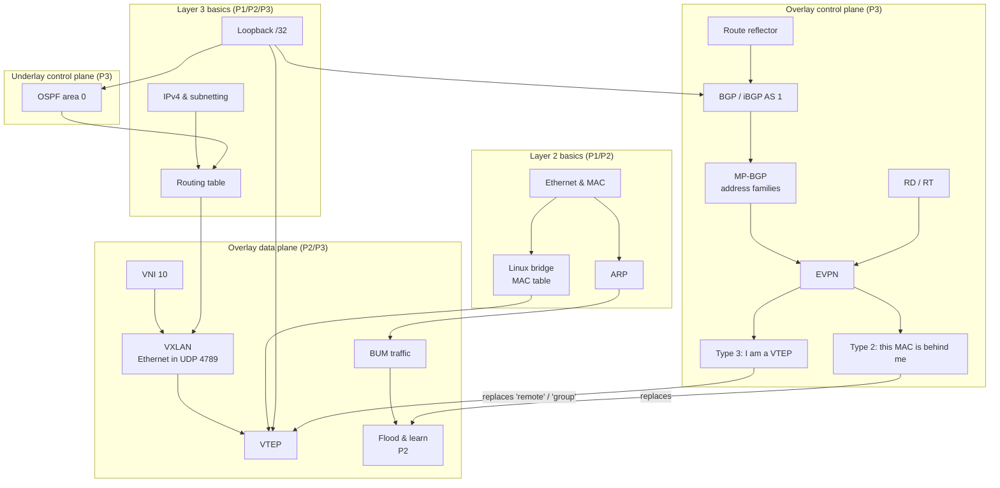

# Concept Map

How all the ideas in the project depend on each other. Read bottom-up: each layer needs the one below it. Back to [[00 Home]].

## Reading the map in words

1. **Hosts talk Ethernet.** They find each other with [[ARP]] (a broadcast) and send frames to MAC addresses — see [[Ethernet and MAC Addresses]].
2. **A switch forwards by MAC.** On the routers, the switch is a [[Linux Bridge]] (`br0`).
3. **Routers forward by IP.** The real network between routers is IP-routed — see [[Routing Basics]] and [[IPv4 and Subnetting]].
4. **[[VXLAN]] glues them together**: it puts the hosts' Ethernet frames inside UDP/IP packets so they cross the routed network. The device that does this is a [[VTEP]]; the segment number is the [[VNI]]. This is [[Underlay vs Overlay]].
5. A VTEP must know **where to send** broadcast/unknown frames ([[BUM Traffic]]) and **which remote VTEP owns which MAC**.
   - In **P2**, it guesses: [[Flood and Learn]].
   - In **P3**, it is told: [[EVPN]] routes (type 3 and type 2) carried by [[BGP]].
6. BGP sessions are opened between [[Loopback Interface|loopbacks]], which must be reachable — that's the job of [[OSPF]] (the underlay).
7. Inside one AS ([[iBGP vs eBGP]]), routes aren't re-advertised between peers, so a [[Route Reflector]] avoids a full mesh.
8. The whole thing splits into [[Control Plane vs Data Plane]]: OSPF + BGP **decide**, VXLAN **carries**.
