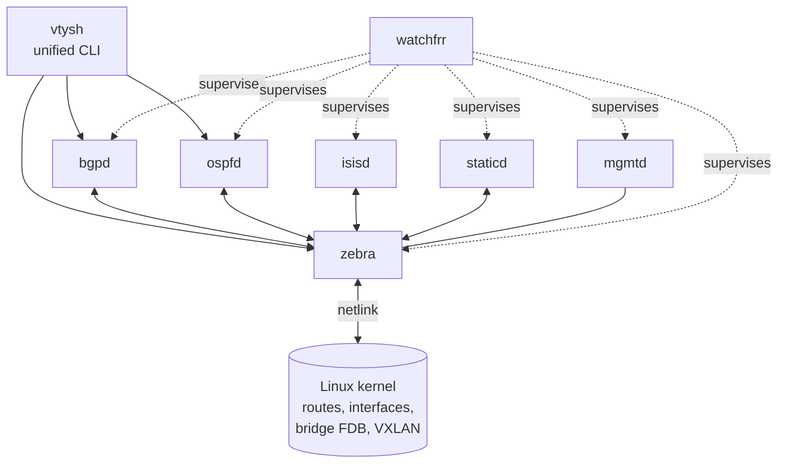

# FRRouting (FRR)

← [[Concept Map]] · Built into the router image: [[P1 - Router Image]]

Open-source routing suite for Linux (fork of Quagga). Used in production by data-center switches (Cumulus/NVIDIA), cloud providers, and SONiC-based systems. It doesn't forward packets itself: it **computes** routes and **programs the Linux kernel**, which forwards.

## Architecture

| Daemon | Role |
|---|---|
| **zebra** | talks to the kernel via netlink: installs routes, watches interfaces, VXLAN devices and bridge FDBs (that's how EVPN learns local MACs/VNIs) |
| **bgpd** | BGP, incl. EVPN |
| **ospfd** | OSPFv2 |
| **isisd** | IS-IS |
| **staticd** | static routes |
| **mgmtd** | central management/config backend (recent FRR) |
| **watchfrr** | starts and restarts daemons |
| **vtysh** | CLI connecting to every daemon over sockets in `/run/frr` |

## Config files

- `/etc/frr/daemons` — which daemons run
- `/etc/frr/frr.conf` — the config (integrated mode)
- `/etc/frr/vtysh.conf` — `service integrated-vtysh-config`

Details: [[P1 - FRR Configuration Files]]. Common commands: [[Commands Cheatsheet]].
