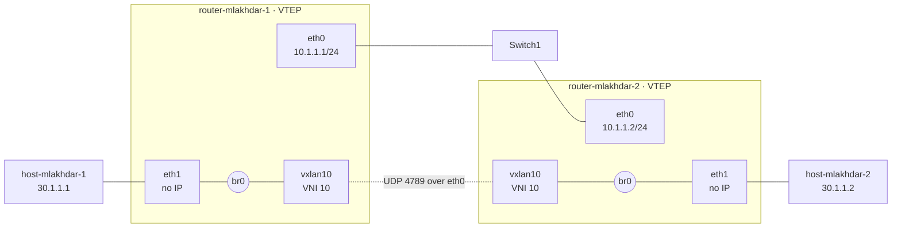

# P2 — Discovering a VXLAN

← [[P1 - Overview]] · [[00 Home]] · Next: [[P3 - Overview]]

![[p2.png]]

## The problem

Two hosts must be **on the same Ethernet LAN (30.1.1.0/24)** — same subnet, no gateway, they ARP each other directly — but physically each one is behind a **different router**, and the routers are connected by an **IP network (10.1.1.0/24)**.

Ethernet frames can't cross an IP router by themselves. So we wrap them: [[VXLAN]].

## Topology

```text
host-mlakhdar-1            router-mlakhdar-1                 router-mlakhdar-2            host-mlakhdar-2
  30.1.1.1/24                   (VTEP)                            (VTEP)                     30.1.1.2/24
     eth0 ──────────── eth1 ─┐                                         ┌─ eth1 ──────────── eth0
                             br0 ── vxlan10 ═══ VNI 10 ═══ vxlan10 ── br0
                        eth0: 10.1.1.1/24 ─────── Switch1 ─────── eth0: 10.1.1.2/24
```



Each router becomes a **switch with a tunnel port**: `br0` (a [[Linux Bridge]]) joins the host port `eth1` and the tunnel `vxlan10`.

## IP plan

| Node | Interface | Address | Layer |
|---|---|---|---|
| router-mlakhdar-1 | eth0 | 10.1.1.1/24 | underlay |
| router-mlakhdar-1 | eth1 | — (bridge port) | overlay |
| router-mlakhdar-2 | eth0 | 10.1.1.2/24 | underlay |
| router-mlakhdar-2 | eth1 | — (bridge port) | overlay |
| host-mlakhdar-1 | eth0 | 30.1.1.1/24 | overlay |
| host-mlakhdar-2 | eth0 | 30.1.1.2/24 | overlay |

| | [[Underlay vs Overlay\|Underlay]] | Overlay |
|---|---|---|
| What | the real network between routers | the virtual LAN between hosts |
| Addresses | 10.1.1.0/24 | 30.1.1.0/24 |
| Who sees it | Switch1 and the routers' eth0 | the hosts |
| In a packet | outer Eth + IP + UDP 4789 + VXLAN | inner Eth + IP + ICMP |

## Two modes

The only difference is **where a [[VTEP]] sends [[BUM Traffic]]** (broadcast, unknown unicast, multicast — e.g. the first ARP request):

| Mode | `vxlan10` option | BUM goes to | Scales? |
|---|---|---|---|
| **static** | `remote 10.1.1.2` | one hard-coded peer | no: one peer per tunnel, written by hand |
| **multicast** | `group 239.1.1.1` | a multicast group every VTEP joins | better, but the underlay must support multicast routing |

In **both** modes, VTEPs **[[Flood and Learn|flood and learn]]**: they discover which MAC is behind which VTEP by watching traffic. → [[P2 - Packet Walk (Flood and Learn)]]

## Files

| File | Role |
|---|---|
| `P2/deploy.sh` | copies each node's script into its container and runs it (arg: `static` \| `multicast`) |
| `P2/scripts/router-mlakhdar-1.sh` | VTEP 1 → [[P2 - Script Walkthrough]] |
| `P2/scripts/router-mlakhdar-2.sh` | VTEP 2, mirrored addresses |
| `P2/scripts/host-mlakhdar-1.sh` | 30.1.1.1/24 |
| `P2/scripts/host-mlakhdar-2.sh` | 30.1.1.2/24 |

> [!note] No FRR in P2
> P2 is pure Linux kernel networking (`ip link`, `bridge`). The FRR daemons run but are unused:
> no routing protocol is needed because both routers' eth0 are in the same subnet.

## Run

```sh
./P2/deploy.sh static       # or: ./P2/deploy.sh multicast
```

Re-running switches mode: the router script deletes `vxlan10` and recreates it.

## Next

- [[P2 - Script Walkthrough]]
- [[P2 - Packet Walk (Flood and Learn)]]
- [[P2 - Verification and Troubleshooting]]
- Limits of P2 → why P3 exists: [[P3 - Overview#From P2 to P3]]
