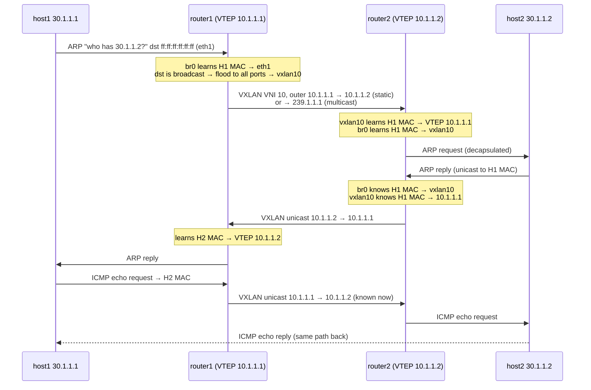

# P2 — Packet walk: `ping 30.1.1.2` from host 1

← [[P2 - Overview]] · Concepts: [[Flood and Learn]], [[ARP]], [[BUM Traffic]]

Start state: all ARP caches and MAC tables empty.

## Step-by-step



## In words

1. host1 wants 30.1.1.2, which is in its own /24 → it needs the MAC → **ARP request, broadcast**.
2. router1's `br0` receives it on `eth1`. It **learns** "host1's MAC is on port eth1". Destination is broadcast → **flood** to every other port → `vxlan10`.
3. `vxlan10` must encapsulate a frame with no known destination VTEP → it uses its **default destination** (the all-zeros FDB entry):
   - static: `remote 10.1.1.2`
   - multicast: `group 239.1.1.1` (every VTEP in the group receives it)
4. router2 receives UDP/4789, checks VNI 10, decapsulates, and its `vxlan10` **learns** "host1's MAC lives behind VTEP 10.1.1.1". `br0` learns "host1's MAC is on port vxlan10". The frame is flooded out `eth1` to host2.
5. host2 answers with a **unicast** ARP reply. router2 now knows exactly where to send it: `br0 → vxlan10 → 10.1.1.1`. No flooding.
6. router1 learns host2's MAC → VTEP 10.1.1.2.
7. From now on every ping is unicast tunnel-to-tunnel.

> [!info] Two MAC tables per router
> - The **bridge FDB** (`br0`): MAC → which port (eth1 or vxlan10).
> - The **VXLAN FDB** (`vxlan10`): MAC → which remote VTEP IP.
> Both show in `bridge fdb show`: the first as `master br0`, the second as `dst 10.1.1.x self`.

## What the packet looks like on the wire (Switch1 link)

```text
┌──────────── outer, added by VTEP ────────────┐┌──────── inner, from host1 ────────┐
│ Eth (R1→R2) │ IP 10.1.1.1→10.1.1.2 │ UDP 4789 │ VXLAN VNI=10 ││ Eth (H1→H2) │ IP 30.1.1.1→30.1.1.2 │ ICMP │
│     14      │          20          │    8     │      8       ││     14      │          20          │ 64   │
```

- Plain ping frame: 14 + 20 + 64 = **98 bytes**
- Encapsulated: 98 + 50 = **148 bytes** → [[Encapsulation Overhead]]

## Multicast mode: what changes in Wireshark

- The **first** ARP request goes to `239.1.1.1` (outer destination IP and a multicast MAC `01:00:5e:01:01:01`).
- After learning, pings go **unicast** 10.1.1.1 ↔ 10.1.1.2.
- To see it again: `ip neigh flush all` on the host (clear ARP) — and wait for / flush the FDB on the routers.

## The weakness that motivates P3

- Every unknown MAC → **flood** to every VTEP. With 1000 VTEPs, that's a lot of useless traffic.
- Static: you must list every peer by hand on every VTEP.
- Multicast: the underlay must run multicast routing (PIM), which many operators avoid.
- Learning is **reactive**: a VTEP only learns a MAC after traffic.

→ P3 replaces all of this with **announcements** over BGP: [[EVPN]].
