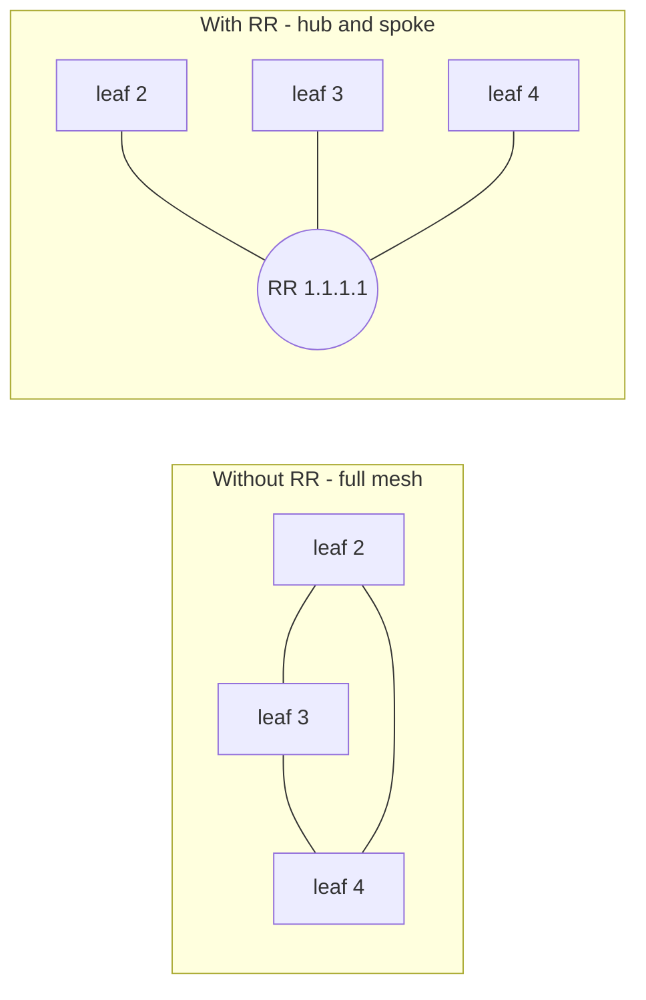

# P3 — BGP and the route reflector

← [[P3 - Overview]] · Concepts: [[BGP]], [[iBGP vs eBGP]], [[Route Reflector]], [[MP-BGP]]

## Why BGP here?

OSPF only knows about **IP prefixes**. We need to distribute something else: "VTEP 1.1.1.2 serves VNI 10", "MAC 02:42:… is behind 1.1.1.2". BGP, through its multiprotocol extension ([[MP-BGP]]), can carry that in the **L2VPN EVPN** address family. See [[EVPN]].

## AS 1, all iBGP

The whole data center is **one Autonomous System, AS 1**. All sessions are therefore **iBGP** (same AS on both ends) — see [[iBGP vs eBGP]].

### The iBGP rule that creates the problem

> A route learned from an iBGP peer is **never** advertised to another iBGP peer.

Why: in eBGP, loops are detected because each AS adds itself to `AS_PATH`; if you see your own AS, you drop the route. Inside one AS the AS_PATH doesn't change, so that protection doesn't work — instead iBGP forbids re-advertisement entirely ("iBGP split horizon").

Consequence: leaf 2's MAC route reaches leaf 3 only if **leaf 2 talks to leaf 3 directly**. With n leaves → full mesh of n(n−1)/2 sessions. 3 leaves = 3 sessions, 100 leaves = 4950.

### The fix: a route reflector

A [[Route Reflector]] is allowed to break that rule for its **clients**: a route received from one client is reflected to all other clients. Each leaf needs **one** session (to the RR). To avoid loops, the RR adds two attributes:
- `ORIGINATOR_ID` = router-id of the leaf that created the route (a leaf drops a route carrying its own id),
- `CLUSTER_LIST` = list of RRs it passed through.

> [!important] The RR does not change the next hop
> A reflected route keeps its **original next hop** (e.g. 1.1.1.2). So leaf 3 sends VXLAN
> traffic **directly to 1.1.1.2** — it doesn't "go to the RR" as a VTEP. Physically the packet
> crosses router-1, but only because that's the OSPF path.



## RR config (router-mlakhdar-1)

```text
router bgp 1
 bgp router-id 1.1.1.1
 neighbor ibgp peer-group
 neighbor ibgp remote-as 1
 neighbor ibgp update-source lo
 bgp listen range 1.1.1.0/29 peer-group ibgp
 !
 address-family l2vpn evpn
  neighbor ibgp activate
  neighbor ibgp route-reflector-client
 exit-address-family
```

| Line | Meaning |
|---|---|
| `router bgp 1` | BGP process in AS 1 |
| `bgp router-id 1.1.1.1` | BGP identity (shows in ORIGINATOR_ID, RDs…) |
| `neighbor ibgp peer-group` | create a **template** named `ibgp` — one config shared by all leaves |
| `remote-as 1` | members are in AS 1 → iBGP |
| `update-source lo` | open sessions **from the loopback** 1.1.1.1. If one link dies but another path exists, the session survives (OSPF reroutes). Also: the leaves are configured to talk to 1.1.1.1, so the RR must answer from that address |
| `bgp listen range 1.1.1.0/29 peer-group ibgp` | **dynamic neighbors**: accept a session from any IP in 1.1.1.0–1.1.1.7 and apply the template. Add a leaf 1.1.1.5 tomorrow → no RR change |
| `address-family l2vpn evpn` | enter the EVPN address family ([[MP-BGP]]) |
| `neighbor ibgp activate` | actually exchange EVPN routes with these peers |
| `neighbor ibgp route-reflector-client` | the RR exception: reflect routes between clients |

The RR has **no** `advertise-all-vni`: it has no VNI, it only relays.

## Leaf config (router-mlakhdar-2)

```text
router bgp 1
 bgp router-id 1.1.1.2
 neighbor 1.1.1.1 remote-as 1
 neighbor 1.1.1.1 update-source lo
 !
 address-family l2vpn evpn
  neighbor 1.1.1.1 activate
  advertise-all-vni
 exit-address-family
```

| Line | Meaning |
|---|---|
| `neighbor 1.1.1.1 remote-as 1` | one peer: the RR's loopback, iBGP |
| `update-source lo` | source = 1.1.1.2, which must be inside the RR's listen range |
| `activate` (in EVPN AF) | exchange EVPN routes with the RR |
| `advertise-all-vni` | ask zebra for every VXLAN device that is in a bridge (here `vxlan10`) and **advertise** it: type 3 immediately, type 2 for every local MAC on `br0`. Also: **install** received routes into the kernel (remote VTEP list, remote MACs) |

## Session lifecycle

1. OSPF converges → 1.1.1.2 can reach 1.1.1.1.
2. Leaf opens **TCP port 179** from 1.1.1.2 to 1.1.1.1.
3. `OPEN` messages: AS, router-id, hold time, **capabilities** (including "I speak L2VPN EVPN" — AFI 25 / SAFI 70).
4. `KEEPALIVE`s → state **Established**.
5. `UPDATE`s carry the EVPN routes (as MP_REACH_NLRI attributes).

States: `Idle → Connect → Active → OpenSent → OpenConfirm → Established`. If stuck in `Active`/`Connect`, the TCP session can't be built: usually the loopback isn't reachable yet → check OSPF first.

## Checks

```sh
vtysh -c "show bgp summary"                       # leaf: 1 neighbor 1.1.1.1; RR: 3 dynamic neighbors (*1.1.1.x)
vtysh -c "show bgp l2vpn evpn summary"
vtysh -c "show bgp neighbors 1.1.1.1"             # state, capabilities, timers
vtysh -c "show bgp l2vpn evpn route detail"       # see ORIGINATOR_ID / CLUSTER_LIST on reflected routes
```
