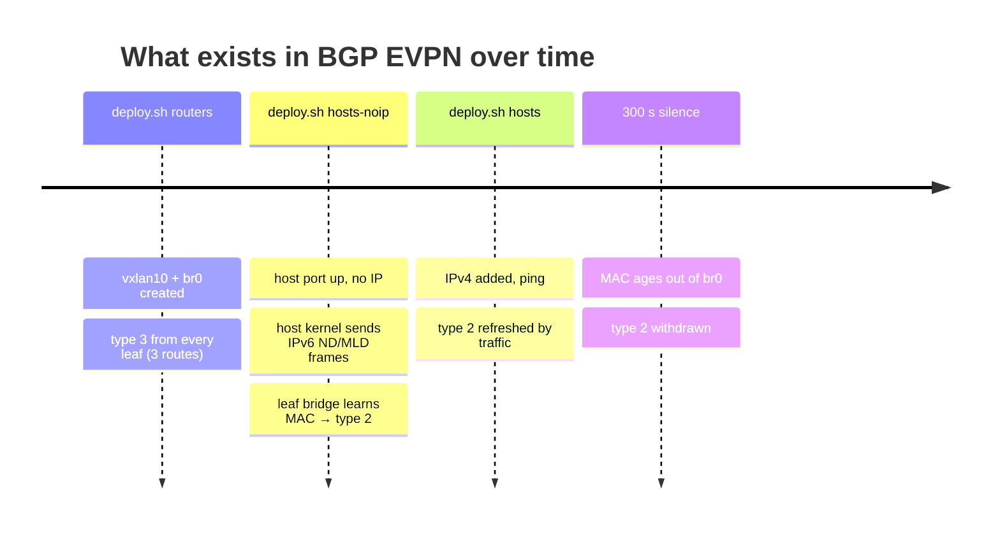

# P3 — EVPN route types 2 and 3

← [[P3 - Overview]] · Concepts: [[EVPN]], [[Route Distinguisher and Route Target]]

![[p3-evpn.png]]

EVPN (RFC 7432, and RFC 8365 for VXLAN) defines several route types. This project uses the two that matter for a pure L2 overlay:

| Type | Name | Says | Replaces in P2 |
|---|---|---|---|
| **3** | Inclusive Multicast Ethernet Tag (IMET) | "I am a VTEP for VNI 10, send me BUM traffic at 1.1.1.2" | `remote` / `group` |
| **2** | MAC/IP Advertisement | "MAC 02:42:… is behind me (1.1.1.2), VNI 10" | flood and learn |

(Others, for curiosity: type 1 & 4 = multihoming, type 5 = IP prefix routes for L3 routing between VNIs.)

## Reading `show bgp l2vpn evpn`

```text
Route Distinguisher: 1.1.1.2:2
 *>i [2]:[0]:[48]:[02:42:aa:20:a5:01]
                 1.1.1.2     100   0 i
                 RT:1:10 ET:8
 *>i [3]:[0]:[32]:[1.1.1.2]
                 1.1.1.2     100   0 i
                 RT:1:10 ET:8
Route Distinguisher: 1.1.1.4:2
 *>  [3]:[0]:[32]:[1.1.1.4]
                 1.1.1.4          32768 i
                 ET:8 RT:1:10
```

### The route key

`[2]:[0]:[48]:[02:42:aa:20:a5:01]`

| Field | Value | Meaning |
|---|---|---|
| `[2]` | route type | MAC/IP |
| `[0]` | Ethernet Tag | 0 = VLAN-based service (one VNI per bridge) |
| `[48]` | MAC length in bits | |
| `[02:42:…]` | the MAC | host-mlakhdar-1 |
| (optional) `:[32]:[20.1.1.1]` | IP length + IP | appears only when the leaf also knows the host IP (needs an SVI / ARP suppression — not configured here, so routes are MAC-only) |

`[3]:[0]:[32]:[1.1.1.2]` = type 3, Ethernet Tag 0, IP length 32, **originating VTEP IP**.

### The flags and attributes

| Field | Meaning |
|---|---|
| `*` | valid |
| `>` | best path |
| `i` (after `>`) | learned via **iBGP** (here: reflected by the RR) |
| no `i` + weight `32768` | **locally originated** (this router created it) |
| next hop `1.1.1.2` | the VTEP to send VXLAN to |
| `100` | LOCAL_PREF (default for iBGP) |
| last `i` | ORIGIN = IGP |
| **RD** `1.1.1.2:2` | [[Route Distinguisher and Route Target\|Route Distinguisher]]: router-id + local index. Makes the route unique even if two leaves advertise the same MAC |
| **RT** `1:10` | Route Target: auto-derived **AS:VNI** = 1:10. A leaf **imports** routes whose RT matches one of its VNIs |
| **ET:8** | BGP Encapsulation extended community, 8 = **VXLAN** |

## When each route appears (the subject's demo)



1. **Type 3 exists with no host at all**: as soon as `vxlan10` (VNI 10) is in `br0` and up, `advertise-all-vni` announces it.
2. **Type 2 appears before any IP**: when the host's port goes up, Linux automatically sends IPv6 link-local frames (Neighbor/Router Solicitation, MLD). The leaf's `br0` sees the source MAC on its host port → zebra notifies bgpd → type 2 route. This proves EVPN is **L2**: it advertises MACs, not IPs.
3. **Type 2 is withdrawn** when the bridge forgets the MAC (aging time 300 s without traffic).

## What the leaves do with received routes

bgpd → zebra → kernel:

| Received | Installed in the kernel as |
|---|---|
| type 3 from 1.1.1.3 | `00:00:00:00:00:00 dev vxlan10 dst 1.1.1.3 self permanent` → a **flood list** entry: BUM is copied to each remote VTEP (**head-end / ingress replication**) |
| type 2 MAC X from 1.1.1.3 | `X dev vxlan10 dst 1.1.1.3 self extern_learn` + `X dev vxlan10 master br0 extern_learn` → unicast goes straight to 1.1.1.3 |

`extern_learn` = "learned by an external control plane", not by the data plane. That's why `vxlan10` has **`nolearning`**: we don't want the kernel to also learn from traffic.

```sh
bridge fdb show dev vxlan10
```

## Why this is better than P2

- **No manual peer list**: add a leaf → it advertises type 3 → everyone adds it to their flood list.
- **No multicast in the underlay**: BUM uses ingress replication to the type-3 list.
- **Proactive**: a MAC is known by every leaf as soon as the host speaks once, not after a flood.
- **Scales** with BGP, which already carries the whole Internet's routing table.
