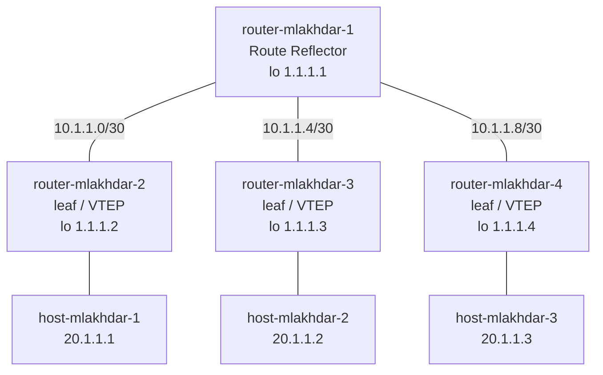

# P3 — Discovering BGP with EVPN

← [[P2 - Overview]] · [[00 Home]]

![[p3-topology.png]]

## Goal

A small **data center fabric**: one **route reflector** (RR) and **3 leaves**, each leaf with one host. The 3 hosts share one LAN (**20.1.1.0/24, VNI 10**) over [[VXLAN]], like P2 — but now:

- the VTEPs **don't flood to find each other**: they are **announced** by BGP ([[EVPN]] type 3),
- remote MACs **aren't learned from traffic**: they are **announced** by BGP (EVPN type 2),
- the underlay is a **real routed network** run by [[OSPF]].

## The three layers

| Layer | Protocol | Job | Runs on | Note |
|---|---|---|---|---|
| Underlay | **OSPF** area 0 | make every loopback 1.1.1.x reachable | 4 routers | [[P3 - Underlay with OSPF]] |
| Overlay control plane | **iBGP + EVPN**, AS 1 | announce VTEPs (type 3) and MACs (type 2) | 4 routers | [[P3 - BGP and the Route Reflector]], [[P3 - EVPN Route Types]] |
| Overlay data plane | **VXLAN** VNI 10, UDP 4789 | carry the hosts' frames | 3 leaves | [[P3 - Packet Walk (EVPN)]] |

> [!quote] One-liner
> **OSPF** makes the loopbacks reachable, **BGP** tells each leaf *who* is where,
> **VXLAN** carries the frames. OSPF and BGP **decide**, VXLAN **carries** — see [[Control Plane vs Data Plane]].

## Topology

```text
                         router-mlakhdar-1  (route reflector)
                          lo 1.1.1.1
              eth0 10.1.1.1   eth1 10.1.1.5   eth2 10.1.1.9
                 /                 |                 \
       eth0 10.1.1.2       eth1 10.1.1.6       eth2 10.1.1.10
     router-mlakhdar-2   router-mlakhdar-3    router-mlakhdar-4     (leaves / VTEPs)
       lo 1.1.1.2          lo 1.1.1.3           lo 1.1.1.4
          eth1               eth0                 eth0              (bridge ports, no IP)
           |                  |                    |
     host-mlakhdar-1    host-mlakhdar-2      host-mlakhdar-3
     eth1 20.1.1.1      eth0 20.1.1.2        eth0 20.1.1.3
```



> [!note] Interface names are not symmetric
> The leaves' uplinks are `eth0`, `eth1`, `eth2` respectively (matching the RR side), and
> host-mlakhdar-1 uses `eth1` while the others use `eth0`. That's just how the cables were
> plugged in GNS3 — the scripts follow it exactly.

## IP plan

| Link / interface | Subnet | Addresses |
|---|---|---|
| RR eth0 ↔ router-2 eth0 | 10.1.1.0/30 | 10.1.1.1 / 10.1.1.2 |
| RR eth1 ↔ router-3 eth1 | 10.1.1.4/30 | 10.1.1.5 / 10.1.1.6 |
| RR eth2 ↔ router-4 eth2 | 10.1.1.8/30 | 10.1.1.9 / 10.1.1.10 |
| Loopbacks | /32 | 1.1.1.1 … 1.1.1.4 |
| Hosts (overlay) | 20.1.1.0/24 | 20.1.1.1 … 20.1.1.3 |

Why /30 and /32? → [[IPv4 and Subnetting]]. Why loopbacks? → [[Loopback Interface]].

## Roles

| | router-1 (RR) | routers 2/3/4 (leaves) |
|---|---|---|
| OSPF | ✅ 3 links + loopback | ✅ uplink + loopback |
| iBGP `l2vpn evpn` | ✅ reflects routes | ✅ one session, to 1.1.1.1 |
| `route-reflector-client` | ✅ towards leaves | — |
| `advertise-all-vni` | — | ✅ |
| `vxlan10` + `br0` (VTEP) | ❌ | ✅ |
| host attached | ❌ | ✅ |

The RR is **not a VTEP**, but VXLAN packets between leaves still **physically cross it** (it's the only path). It forwards them as normal IP packets, without decapsulating. Control plane role ≠ data plane role.

## Run

```sh
./P3/deploy.sh routers      # OSPF + BGP EVPN + VXLAN on the 4 routers; wait ~30 s
./P3/deploy.sh hosts-noip   # hosts' ports up, no IP → type 2 routes appear
./P3/deploy.sh hosts        # hosts get 20.1.1.x/24 → ping works
./P3/deploy.sh              # (= all) everything at once
```

The three-step order reproduces the subject's demonstration: type 3 routes exist with **no host**; type 2 routes appear **before any IP**. See [[P3 - EVPN Route Types]].

## From P2 to P3

| | P2 static | P2 multicast | P3 BGP EVPN |
|---|---|---|---|
| Find the other VTEPs | `remote <ip>` by hand | join group 239.1.1.1 | **type 3** routes |
| Learn remote MACs | flood and learn | flood and learn | **type 2** routes |
| Underlay | one shared subnet | one shared subnet + multicast | **OSPF**, routed /30s |
| VTEP address | link IP | link IP | **loopback** |
| `vxlan10` options | `remote` | `group` | none of those, + **`nolearning`** |
| Uses FRR? | no | no | yes |
| Scales | poorly | needs multicast routing | yes |

## Sub-notes

- [[P3 - Underlay with OSPF]]
- [[P3 - BGP and the Route Reflector]]
- [[P3 - EVPN Route Types]]
- [[P3 - Script Walkthrough]]
- [[P3 - Packet Walk (EVPN)]]
- [[P3 - Verification and Troubleshooting]]
