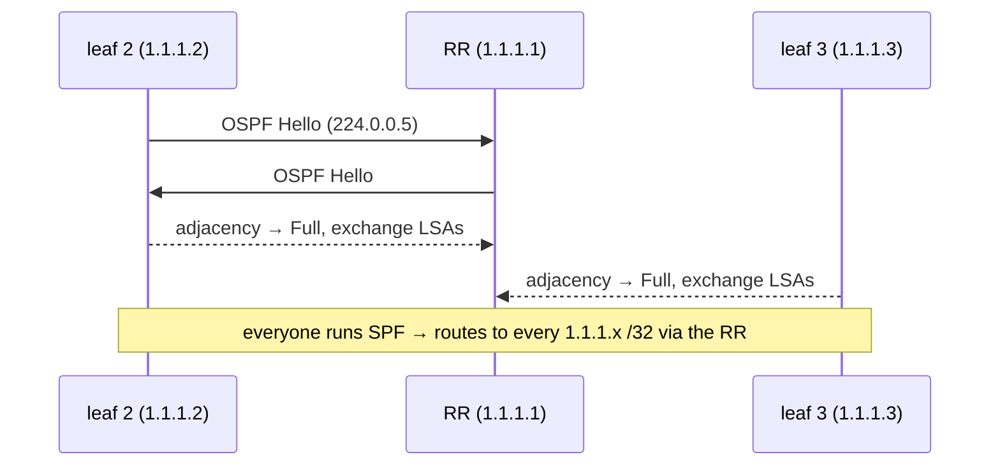
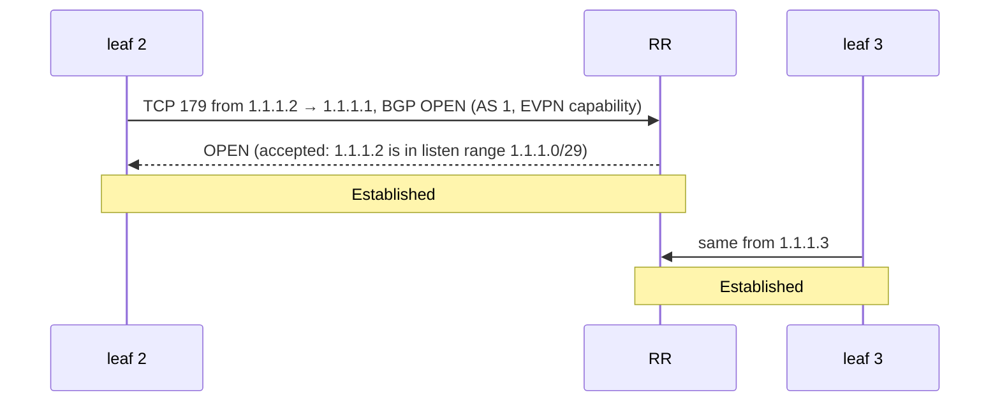
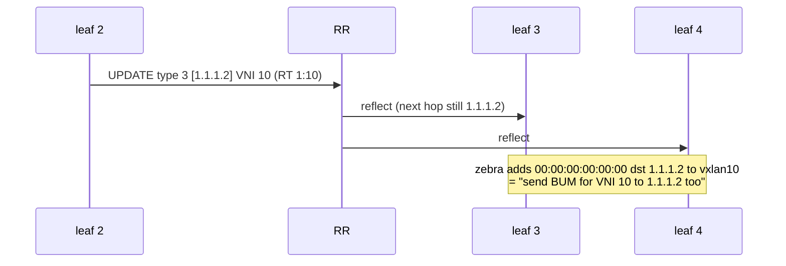
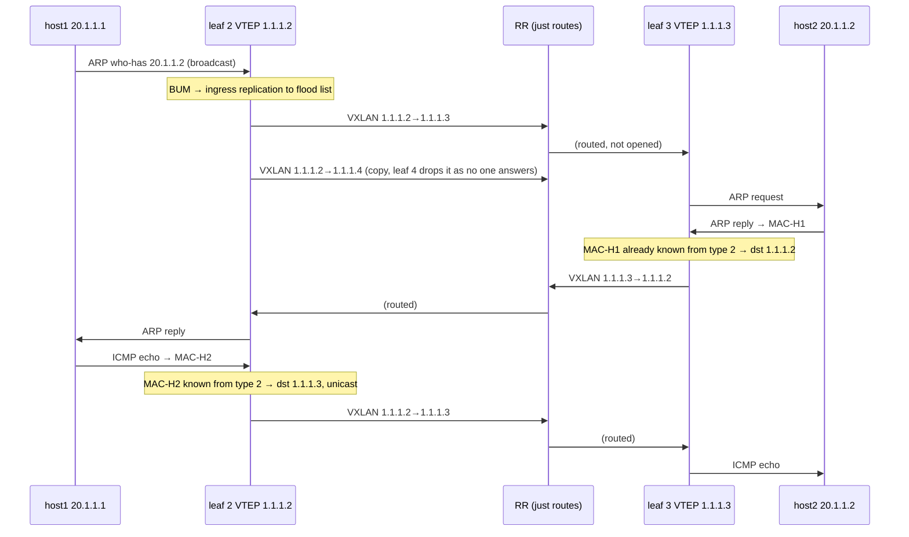

# P3 — Packet walk: from boot to `ping 20.1.1.2`

← [[P3 - Overview]]

The full life of the fabric, in order. Compare with [[P2 - Packet Walk (Flood and Learn)]].

## Phase 1 — Underlay converges (OSPF)



Result: `1.1.1.2` can reach `1.1.1.3` (via 10.1.1.1 → 10.1.1.6). Details: [[P3 - Underlay with OSPF]].

## Phase 2 — BGP sessions come up



## Phase 3 — Type 3 routes (VTEP discovery)



Each leaf now has a **flood list** = every other leaf. No multicast, no `remote` written by hand.

## Phase 4 — Host 1 comes up (type 2)

1. host-1's port goes up; it sends some frame (IPv6 ND, or later an ARP).
2. leaf 2's `br0` learns `MAC-H1 → eth1` (local learning still happens on the host port — `nolearning` only affects the VXLAN device).
3. zebra sees the new FDB entry → tells bgpd → bgpd sends **type 2 `[MAC-H1]`, next hop 1.1.1.2**.
4. RR reflects it to leaves 3 and 4.
5. Leaves 3 and 4 install `MAC-H1 dev vxlan10 dst 1.1.1.2 extern_learn`.

Same for hosts 2 and 3. **Every leaf knows every MAC before any ping.**

## Phase 5 — `ping 20.1.1.2` from host 1



> [!note] ARP is still a broadcast
> EVPN doesn't remove ARP by itself; the ARP request is still BUM, replicated to every VTEP in the
> flood list. What disappears is the *unknown unicast* flooding and the *data-plane learning*.
> (Real fabrics add "ARP suppression" with MAC+IP type 2 routes so the leaf answers ARP locally —
> not configured in this project.)

## The packet on the RR ↔ leaf 2 link

![[p3-wireshark.png]]

```text
Eth │ IP 1.1.1.2 → 1.1.1.3 │ UDP src=<hash> dst=4789 │ VXLAN VNI 10 ║ Eth H1→H2 │ IP 20.1.1.1→20.1.1.2 │ ICMP
```

- Outer IPs are **loopbacks** — reachable only thanks to OSPF.
- The RR forwards it by looking at the **outer** IP only. It never opens the envelope.
- 148 bytes per ping frame = 98 + **50** ([[Encapsulation Overhead]]), same as P2.
- The outer UDP **source port** is a hash of the inner flow → different flows take different paths when there are several equal-cost paths (ECMP). Here there's one path, so it doesn't matter.

![[p3-ping.png]]
